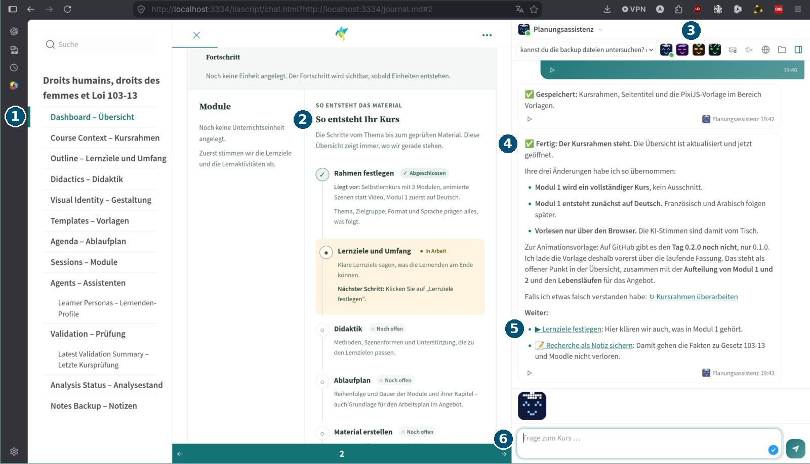

<!--
author:   Sebastian Zug, André Dietrich
email:    sebastian.zug@informatik.tu-freiberg.de
version:  0.2.0
language: de
narrator: German Female

comment:  Kurzer Einstieg für das Gespräch mit GovTech: Interaktive Lernmaterialien für KI-Kompetenz in Behörden, ein Basiskurs, viele individuelle Lernpfade.

@style
@import url('https://fonts.googleapis.com/css2?family=Inter:wght@400;700;900&display=swap');

:root, :root[class] {
  --color-highlight: 0, 81, 118 !important;
  --color-highlight-dark: 0, 60, 90 !important;
  --global-font-family: 'Inter', sans-serif !important;
  --global-font-headline: 'Inter', sans-serif !important;
}

h1, h2, h3, h4, h5, h6 {
  font-family: 'Inter', sans-serif !important;
  font-weight: 900 !important;
  color: #005176 !important;
}

blockquote { border-left-color: #005176 !important; }
th { background-color: #005176 !important; color: #ffffff !important; }

.hero {
  border-left: 6px solid #005176;
  background: rgba(0, 81, 118, 0.06);
  border-radius: 0 10px 10px 0;
  padding: 1.6rem 1.8rem;
  margin: 1.2rem 0 1.5rem;
}
.hero-kicker {
  text-transform: uppercase;
  letter-spacing: 0.12em;
  font-size: 0.75em;
  opacity: 0.7;
}
.hero-claim {
  font-size: 1.25em;
  font-weight: 700;
  color: #005176;
  margin-top: 0.4rem;
}
.hero-meta { line-height: 1.7; opacity: 0.85; }
@end
-->

[](https://liascript.github.io/course/?https://raw.githubusercontent.com/LiaPlayground/KI_in_LiaScript/main/README.md)


# LiaScript für die Vermittlung von KI-Kompetenzen

--{{0}}--
Herzlich willkommen! Wir zeigen Ihnen heute, wie LiaScript Behörden dabei unterstützen kann, KI-Kompetenzen zu vermitteln: mit einem Basiskurs und vielen individuellen Lernpfaden.

<div class="hero">
  <div class="hero-claim">Konzepte und Entwicklungen</div>
</div>

<div class="hero-meta">
  <b>Prof. Dr. Sebastian Zug</b> · <b>Dr. André Dietrich</b><br>
  TU Bergakademie Freiberg · 23. Oktober 2026
</div>

## LiaScript im Einsatz 

--{{0}}--
LiaScript ist 2017 an der TU Bergakademie Freiberg entstanden und wird seitdem kontinuierlich weiterentwickelt. Die Idee ist einfach: Ein Kurs wird als gut lesbarer Text beschrieben, und der Browser macht daraus ein interaktives Lernangebot.

**[LiaScript](https://de.wikipedia.org/wiki/LiaScript)** – 2017 an der TU Bergakademie Freiberg entstanden, seitdem kontinuierlich weiterentwickelt

* **Ein Kurs ist ein Text:** Inhalte werden in einer einfachen Beschreibungssprache geschrieben
* **Interaktiv:** Der Browser erzeugt daraus ein interaktives Lernangebot, das auf allen Geräteklassen läuft
* **Offen:** Open Source, kostenfrei, ohne Plattformbindung
* **Im Einsatz** weltweit in Schulen, Hochschulen und Weiterbildung

> [!TIP]
> __An dieser Stelle stehen nicht die technischen Features im Vordergrund, sondern die organisatorischen und didaktischen Möglichkeiten, die sich mit dem Einsatz von LiaScript in Behörden ergeben.__

### Mehrere Lernsituationen in einem Kurs

--{{0}}--
Beschäftigte lernen in sehr unterschiedlichen Situationen: allein am Arbeitsplatz, in einer Präsenzschulung, unterwegs. Statt für jede Situation ein eigenes Format zu produzieren, bedient ein einziger Kurs alle.

**Ein Kurs – ohne Neuproduktion für jede Situation:**

| Lernsituation                        | Nutzung des Kurses                                            |
| :----------------------------------- | :------------------------------------------------------------ |
| Selbstlernen am Arbeitsplatz         | Lehrbuch-Modus, eigenes Tempo, Wissenschecks                  |
| Präsenzschulung oder Dienstbesprechung | Folien-Modus für Vortragende, Live-Abstimmungen im Raum      |
| Unterwegs, im Zug, im Außendienst    | auf dem Smartphone, auch offline                              |
| Zuhören statt Lesen                  | vertonte Präsentation, die Inhalte werden vorgelesen          |
| Behördliche Lernplattform            | Export z. B. nach Moodle oder ILIAS (SCORM)                   |

--{{1}}--
Probieren Sie es aus: Oben rechts lässt sich zwischen Lehrbuch, Folien und Präsentation umschalten. Es ist immer derselbe Kurs.

{{1}}
> **Live ausprobieren:** Oben rechts zwischen Lehrbuch, Folien und Präsentation wechseln. Es bleibt derselbe Kurs.

### Barrierefreier Zugang

--{{0}}--
Barrierefreiheit ist für die Verwaltung keine Kür, sondern Pflicht. Und sie betrifft nicht nur Menschen mit Beeinträchtigungen, sondern auch Beschäftigte, die Deutsch nicht als Erstsprache sprechen.

* **Vorlesen:** Alle Inhalte können per Sprachausgabe abgespielt werden, ohne Tonstudio und ohne Neuaufnahme bei Änderungen.
* **Übersetzen:** Der Kurs lässt sich direkt im Browser in andere Sprachen übersetzen.
* **Anpassen:** Schriftgröße, Kontrast und Dunkelmodus stellt jede Person selbst ein.
* **Screenreader-tauglich:** Die Inhalte bestehen aus strukturiertem Text, nicht aus Bildern von Text.

### Gemeinsames Lernen

> **Live im Klassenraum:** Alle Teilnehmenden antworten gleichzeitig, die Ergebnisse erscheinen sofort, ohne Anmeldung und ohne Server der Behörde.

--{{0}}--
Eine Frage, die Sie kennen dürften: aus Ihrem Kurs zum Once-Only-Prinzip. Probieren Sie es aus.

**Testen Sie Ihr Wissen** – aus Ihrem Kurs KF02 „Once-Only-Prinzip“:

Welche Voraussetzung ist **keine** zentrale Grundlage für die erfolgreiche Umsetzung des Once-Only-Prinzips?

[( )] Datenqualität
[( )] Interoperabilität
[( )] Datenschutz
[(X)] Häufige manuelle Dateneingabe
[[?]] Once-Only heißt: Daten werden nur einmal erfasst.
***
Häufige manuelle Dateneingabe ist genau das, was Once-Only vermeiden will. Datenqualität, Interoperabilität und Datenschutz müssen dagegen zusammenspielen.
***

{{1}}
Das Ganze können wir auch im Chat realisieren - hier ist wiederum der Interpreter aktiv, was die Möglichkeit schafft, interaktive Aufgaben neben dem Dokument zu erzeugen. 

{{1}}
```markdown
Wie viele Angaben müssen Bürgerinnen und Bürger machen? (fiktive Werte)

<!-- data-type="barchart" data-show -->
| Verwaltungsleistung   | Angaben heute | Angaben mit Once-Only |
| --------------------- | ------------: | --------------------: |
| Wohnsitz ummelden     |            14 |                     4 |
| Kfz ummelden          |            18 |                     6 |
| Kindergeld beantragen |            25 |                     9 |
| Wohngeld beantragen   |            32 |                    12 |
```

--{{1}}--
Sobald ich diesen Text in den Chat des Klassenraums kopiere, sehen alle Teilnehmenden sofort ein interaktives Diagramm.

## KI als Partner im Lernprozess

--{{0}}--
Eben haben Sie gesehen: Was ich in den Chat des Klassenraums schreibe, erscheint bei allen sofort als interaktiver Inhalt. Diese Rolle kann auch eine KI übernehmen.

> Eben im Klassenraum-Chat: **Ich** habe einen Text geschrieben, und bei **allen** erschien ein interaktiver Inhalt.
>
> **Diese Rolle kann auch die KI übernehmen.**

{{1}}
****

**Was wäre, wenn sich jede Person ihren eigenen Lernpfad aus dem Basiskurs bauen könnte?**

****

--{{1}}--
Und die KI kann das nicht nur für alle gleichzeitig, sondern für jede Person einzeln: passend zu ihrer Rolle und ihren Fragen.

{{2}}
****

```ascii
                   +-----------------------------+
                   |  Geprüfter Basiskurs        |
                   |  "Once-Only-Prinzip"        |
                   +--------------+--------------+
                                  |
                       Fragen im Chat zur Rolle
                                  |
        +-------------------------+-------------------------+
        |                         |                         |
        v                         v                         v
+----------------+       +----------------+       +----------------+
| Meldebehörde   |       | Kfz-Zulassung  |       | IT-Referat     |
|                |       |                |       |                |
| Fallquiz:      |       | Übung: Welche  |       | Schnittstellen |
| Umzug melden   |       | Daten kommen   |       | ausprobieren   |
|                |       | woher?         |       |                |
+----------------+       +----------------+       +----------------+
```

{{2}}
> Ihr Kurs sagt: *„Ihre Rolle als datenhaltende Stelle“*. Aber **welche** Stelle? Das klärt der Chat.

****

--{{2}}--
Grundlage ist ein geprüfter Basiskurs. Jede Person stellt im Chat ihre eigenen Fragen, und die KI antwortet nicht nur mit Text, sondern erzeugt passendes, interaktives Lernmaterial: Quizze, Übungen, Schaubilder, Simulationen.


## Kurs mit KI-Planungsassistenz

> [!TIP]
> Damit verschwimmt die Grenze zwischen Erstellen und Lernen: Die KI arbeitet direkt im Kurs mit, speichert Änderungen und schlägt die nächsten Schritte zum Anklicken vor.



1. **Der Kurs** – Struktur links, Inhalte in der Mitte
2. **Der Kurs wächst mit** – die KI pflegt den Arbeitsstand: Rahmen, Lernziele, Didaktik, Material …
3. **Spezialisierte Assistenten** – je nach Aufgabe umschaltbar
4. **Die KI schreibt direkt in den Kurs** – Änderungen werden gespeichert, die Übersicht aktualisiert
5. **Nächste Schritte zum Anklicken** – statt langer Antworttexte
6. **Fragen in natürlicher Sprache** – zum Kurs und zur aktuellen Seite

## Vergleich mit anderen Ansätzen

--{{0}}--
Damit unterscheidet sich der Ansatz deutlich von dem, was man heute meist sieht.

|                           | Chat mit Dokumenten | KI erstellt Kurse   | **Unser Ansatz**                                  |
| :------------------------ | :------------------ | :------------------ | :------------------------------------------------ |
| Ergebnis                  | Text-Antwort        | ein Kurs für alle   | **interaktives Material für die einzelne Person** |
| Rolle der Lernenden       | lesen               | durcharbeiten       | **ausprobieren, sich prüfen, nachfragen**         |
| Grundlage                 | beliebige Dokumente | einmalige Erzeugung | **geprüfter Basiskurs**                           |
| Was bleibt?               | Chatverlauf         | statischer Kurs     | **Lernpfad, der gespeichert und geteilt werden kann** |

--{{1}}--
Kurz gesagt: Die KI ist hier nicht nur Antwortmaschine und nicht nur Autorenwerkzeug, sondern ein Tutor, der mit den Mitteln des Kurses arbeitet.

{{1}}
> **Die KI erklärt nicht nur – sie baut das passende Lernmaterial.**


## Live-Demo

--{{0}}--
Genug erzählt. André zeigt Ihnen jetzt, wie das live aussieht.

**André Dietrich zeigt, wie das in der Praxis aussieht.**

Achten Sie auf:

- [ ] Die KI kennt den Kurs und die aktuelle Seite
- [ ] Antworten enthalten Übungen, Quizze und Simulationen
- [ ] Bei falschen Antworten gibt es gezielte Hinweise statt der Lösung
- [ ] Jede Rolle bekommt einen anderen Lernpfad

